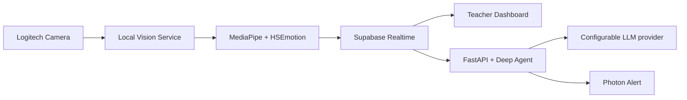

# Cues — Product Requirements Document

*HackPrinceton Fall 2026 · 36-hour build · Version 2*

---

## 1. Product summary

**Cues** is an AI-powered classroom support system for special education (SEN) settings.

In classrooms where one teacher is responsible for many students moving at different speeds, the teacher cannot continuously watch every student. Cues uses a camera to observe simple, teacher-defined physical tasks, track whether a student is making progress, and surface timely cues about who may need help.

Cues is designed to **assist the teacher, not replace them**. Computer vision handles simple, observable signals; a rules layer decides when an event is meaningful; an AI support agent gathers context and decides which approved tools to use; and the teacher remains in control of any instructional change.

### Core product loop

1. The teacher selects or speaks a task.
2. The local camera pipeline observes student task attempts.
3. MediaPipe measures hand movement and HSEmotion provides facial-expression context.
4. Cues converts local model outputs into task-progress events.
5. Supabase synchronizes the current classroom state.
6. The rules engine determines when a situation is meaningful enough to invoke the agent.
7. The Deep Agent retrieves context, chooses tools, and creates a teacher alert or support suggestion.
8. Photon can notify the teacher when attention is needed.
9. The teacher reviews the alert and decides whether to approve an instructional change.

**Student camera frames never go to the LLM.**

---

## 2. Problem & motivation

In SEN classrooms, students can have very different communication, motor, sensory, and learning needs. One teacher may need to support many students simultaneously, making it difficult to notice immediately when an individual student has completed a task, is repeatedly struggling with it, or may need assistance.

Practitioner input gathered for this project indicates that:

- wearable devices may be uncomfortable or impractical for some learners;
- camera-based sensing is less intrusive for simple classroom tasks;
- simple observable actions such as hand gestures can be evaluated more reliably than complex multi-step activities;
- automation should route teacher attention rather than attempt to replace teacher judgment.

Cues addresses this as an **attention-routing problem**.

The product does not attempt to determine a student's diagnosis, intent, or internal emotional state. Instead, it combines observable task-progress signals with optional facial-expression evidence and uses those signals to help the teacher decide where to look next.

---

## 3. Goals and non-goals

### 3.1 MVP goals

1. **Teacher-controlled task selection**
   - The teacher can select a task using large dashboard buttons.
   - The teacher can also use push-to-talk voice commands.
   - Voice input maps to the existing task list rather than allowing unrestricted LLM-generated commands.

2. **Camera-based task observation**
   - One Logitech camera connected to the station laptop.
   - MVP supports one student reliably.
   - Two fixed seat zones from one camera are supported when framing and performance allow.

3. **Hand and pose-related task checks**
   - Rule-based task: e.g. “raise your hand.”
   - Built-in/simple gesture task: e.g. “thumbs up.”
   - Teacher-defined static gestures learned from a few demonstrations.

4. **Teacher-defined gesture recording**
   - The teacher records 3–5 examples of a target gesture.
   - Cues normalizes the MediaPipe landmarks and calibrates a nearest-neighbor match threshold.
   - A newly recorded gesture can be used within seconds.
   - No model training from scratch.

5. **Facial-expression context**
   - HSEmotion runs locally on face crops.
   - Native expression probabilities are preserved.
   - Facial-expression evidence can increase alert priority, but **never independently determines that a student is struggling**.

6. **Task-progress state**
   - Each student/seat has a current task and current status.
   - Cues distinguishes success, in-progress attempts, repeated misses, no progress, and tracking loss.
   - Tracking failures are never counted as student failures.

7. **Live teacher dashboard**
   - Shows one card per student/seat.
   - Displays current task, progress state, latest task event, task match score, and optional expression context.
   - Simulated students, if used, are visibly labeled as simulated.

8. **Rules engine**
   - Converts low-level events into meaningful triggers.
   - Applies cooldowns to prevent alert flooding.
   - Invokes the agent only when meaningful context exists.

9. **Agentic support workflow**
   - LangChain Deep Agents runs on the FastAPI backend.
   - The agent uses a configurable LLM provider and model. Selection is undecided; Groq and SpaceXSI are under consideration.
   - The agent chooses which available tools to call based on the current situation.
   - It retrieves task state, recent attempts, support preferences, and current contextual signals before deciding what action is appropriate.
   - Instructional changes always require teacher approval.

10. **Teacher notification**
    - Photon sends a concise alert when the teacher may need to intervene.
    - Notifications contain no images and no raw facial-expression label.

11. **Event log**
    - Meaningful task outcomes, alerts, agent actions, and teacher decisions are stored as structured events.
    - The event log is the basis for future progress summaries and analytics.

### 3.2 Non-goals for the MVP

- No ESP32, Arduino, buttons, LEDs, haptics, or other physical controls.
- No object-state recognition such as “open your book.”
- No YOLO, MobileNet object classifier, or custom object detector.
- No whole-classroom camera.
- No face recognition or biometric identification.
- No attempt to infer diagnoses, intent, attention, or internal emotional state.
- No emotion-based behavioral scoring.
- No automatic instructional changes without teacher approval.
- No raw video or images sent to Supabase, any LLM provider, LangChain, Photon, or any other cloud service.
- No raw camera frames sent to the LLM.
- No training of large models from scratch.
- No complex multi-step physical tasks.
- No individualized curriculum planner or IEP editor.
- No real student data during the hackathon.
- No demo choreography in the PRD; demo design will be created separately after the product works.

---

## 4. Recommended technology stack

| Component | Recommended technology |
|---|---|
| Frontend / UI | Next.js + Tailwind |
| Local hand tracking | MediaPipe Hand Landmarker |
| Gesture matching | Normalized landmark nearest neighbor |
| Facial-expression context | `hsemotion-onnx` with `enet_b0_8_best_vgaf` |
| Realtime data | Supabase Postgres + Realtime |
| Agent orchestration | LangChain Deep Agents |
| LLM inference | Configurable provider and model (TBD) |
| Physical hardware | Logitech camera |
| Teacher messaging | Photon |
| Agent / API backend | FastAPI (Python) |

LLM provider and model selection is undecided; Groq and SpaceXSI are under consideration. Keep the provider/model configurable through environment variables so they can be replaced without changing agent logic. These settings are placeholders for future integration; no provider is implemented yet.

Example:

```env
LLM_PROVIDER=
LLM_MODEL=
LLM_API_KEY=
```

---

## 5. Architecture

### 5.1 High-level architecture



### 5.2 Architecture principles

**Local perception first.**  
Camera frames are processed on the station laptop.

**Events, not video.**  
Only structured task events, match scores, timestamps, and necessary contextual values are sent to Supabase.

**LLM only on meaningful events.**  
The Deep Agent is not called on every frame or every attempt. The rules engine invokes it only when the system has enough evidence that teacher attention may be useful.

**LLM never sees camera frames.**  
The model receives structured state such as:

```json
{
  "seat_id": "S1-L",
  "task": "custom_gesture_01",
  "recent_attempts": ["miss", "miss", "miss"],
  "time_on_task_seconds": 34,
  "gesture_match_scores": [0.31, 0.38, 0.35],
  "expression_context": {
    "label": "sadness",
    "probability": 0.63,
    "duration_seconds": 6,
    "supporting_only": true
  }
}
```

It does **not** receive images.

---

## 6. Local vision service

The station laptop runs a Python vision service responsible for webcam capture, local model inference, task matching, and event generation.

### 6.1 Camera

- Logitech webcam.
- Start at 640×480.
- Target a smooth enough frame rate for interaction rather than maximum throughput.
- The vision service owns webcam access to avoid multiple processes competing for the device.

### 6.2 Seat assignment

MVP priority:

1. **One student / one active zone must work reliably.**
2. Two fixed seat zones are supported as an extension of the same pipeline.

For two-seat operation:

- divide the image into configurable left and right zones;
- assign detected hands/faces by center point;
- include a small dead band near the divider to reduce cross-seat misassignment;
- provide a simple “swap seats” control.

No face recognition is used.

---

## 7. Hand tracking and gesture matching

### 7.1 MediaPipe Hand Landmarker

For each detected hand, store the 21 hand landmarks.

Each hand contains:

```text
21 landmarks × (x, y, z) = 63 values
```

### 7.2 Landmark normalization

Before gesture comparison:

1. translate the wrist landmark to the origin;
2. scale coordinates relative to hand size;
3. consistently mirror left/right hands if needed;
4. flatten the normalized landmarks into a 63-dimensional vector.

This makes matching less sensitive to image position, distance from the camera, and handedness.

### 7.3 Teacher-defined gesture recording

The teacher selects an activity and records 3–5 examples of the target gesture.

The system stores normalized landmark vectors locally.

The teacher can optionally record examples of “rest / other” hand states to improve rejection of unrelated poses.

Templates remain on the local station.

### 7.4 Nearest-neighbor matching

For a new hand pose:

```text
d_target = distance to nearest target example
d_other  = distance to nearest other/rest example
```

A gesture is considered a candidate match when:

```text
d_target < calibrated_target_threshold
AND
d_target < d_other
```

if an `other/rest` class exists.

### 7.5 Match score

The UI shows a **match score**, not a probability.

The score is derived from the distance between the observed normalized landmark vector and the nearest target template.

Example form:

```text
match_score = clamp(1 - d_target / rejection_threshold, 0, 1)
```

The exact formula may be adjusted during calibration.

The PRD intentionally does **not** describe this number as statistical confidence because nearest-neighbor distance is not a calibrated probability.

### 7.6 Per-activity calibration

There is no universal success threshold for every task.

Each activity stores its own matching configuration:

```json
{
  "id": "custom_gesture_01",
  "check_type": "gesture",
  "success_threshold": 0.78,
  "review_threshold": 0.58,
  "config": {
    "calibration": {
      "target_distance_threshold": 0.41
    }
  }
}
```

Thresholds are derived from or tuned against the examples recorded for that task.

---

## 8. Rule-based task checks

Some tasks do not need a learned gesture matcher.

### Raise hand

A simple geometric rule may use hand and face position:

```text
wrist_y < face_top_y
```

or another robust coordinate comparison determined during testing.

The output is primarily boolean.

This task does not use the same scoring threshold as the nearest-neighbor gesture matcher.

---

## 9. Facial-expression context

### 9.1 Model

Use:

```text
hsemotion-onnx
model: enet_b0_8_best_vgaf
```

Run it locally on a face crop.

### 9.2 Preserve native model output

Do **not** drop classes and renormalize probabilities.

Keep the model’s native expression distribution internally, including:

- anger
- contempt
- disgust
- fear
- happiness
- neutral
- sadness
- surprise

The original probability associated with each class is preserved.

### 9.3 Temporal smoothing

Expression estimates are noisy frame-to-frame.

Maintain a short rolling window and average or otherwise smooth the probabilities before creating contextual signals.

Example:

```text
rolling window: 2 seconds
expression evaluation frequency: ~2–3 Hz
```

Exact values should be tuned on the demo laptop.

### 9.4 Expression as supporting evidence only

Cues never declares:

> “This student is struggling because they look sad.”

Instead:

1. task behavior establishes whether progress is difficult;
2. expression can add contextual evidence;
3. the combined state may increase urgency or priority.

Example:

```text
sustained stalled task progress
+
sustained sadness/anger/fear signal
=
higher-priority teacher cue
```

Expression by itself does **not** trigger a “student is struggling” conclusion.

### 9.5 Expression signal

A contextual expression signal may be created when a relevant native probability remains above a configured threshold for a persistence window.

Example configuration:

```json
{
  "labels": ["anger", "fear", "sadness"],
  "min_probability": 0.50,
  "min_duration_seconds": 5
}
```

These are configuration values, not clinical cutoffs.

The dashboard may display current expression context and probability for debugging/demo use, but this should be framed as **model output**, not as a verified emotional state.

---

## 10. Task progress logic

Each seat has a task-specific state machine.

Possible statuses:

```text
idle
in_progress
review
done
needs_help
tracking_lost
```

### 10.1 Success

Success is determined using the current activity’s own checker and calibration.

Examples:

- raise hand → boolean rule true for the configured persistence time;
- custom gesture → match score above that activity’s success threshold.

### 10.2 Review

Some activities may define a review band.

For example, a custom gesture may be close to the target but not high enough for automatic completion.

This creates:

```text
review_needed
```

The teacher can manually verify the task.

### 10.3 Failed attempt

A failed attempt should only be recorded when:

- the relevant body part is clearly detected;
- tracking is stable;
- the student appears to be making an attempt;
- the activity-specific matcher does not pass.

A short cooldown prevents many events from being emitted for one continuous attempt.

### 10.4 No progress

Each activity can define its own `no_progress_seconds`.

The demo configuration may use a shorter value than a real classroom deployment.

### 10.5 Tracking loss

If the required hand or face is missing for the configured duration:

```text
tracking_lost
```

Tracking-loss time pauses progress timers and is excluded from miss counts.

---

## 11. Rules engine

The rules engine operates on structured events from Supabase.

Its purpose is to decide **when the AI agent should be invoked**, not to perform open-ended reasoning itself.

### Example triggers

- sustained stalled task progress;
- no progress for the activity-specific timeout;
- teacher manually requests agent help;
- stalled progress with supporting sustained expression context;
- a previously flagged situation changes substantially.

### Alert cooldown

Apply cooldowns by:

```text
seat + alert reason
```

to avoid repeated notifications.

Example:

```text
one alert per seat per reason every 2 minutes
```

Configuration should be easy to tune.

### Expression rule

Expression context should not independently create a task-struggle alert.

Instead:

```text
task difficulty signal
+
expression evidence
→ increase priority / context
```

---

## 12. AI support agent

### 12.1 Agent stack

- LangChain Deep Agents
- FastAPI
- Configurable LLM provider and model (TBD; Groq and SpaceXSI are under consideration)

### 12.2 Agent objective

The agent determines:

> Given this student’s current task, recent attempts, contextual signals, and approved support preferences, what should Cues do next?

The answer is expressed through **tool choices**, not unrestricted text generation.

### 12.3 Planned tool concepts (not implemented)

The following are earlier workflow concepts, not implemented capabilities. The focused initial Deep Agent tool plan is in §12.6. The future agent may choose among tools such as:

#### `get_session_state`

Returns:

- current activity;
- current status;
- time on task;
- latest task match score;
- current contextual signals.

#### `get_recent_attempts`

Returns recent structured events for the seat:

- successes;
- misses;
- reviews;
- tracking loss;
- previous alerts.

#### `get_support_preferences`

Returns the simulated / teacher-configured support preferences for the seat.

Examples:

- repeat demonstration first;
- prefer simpler verbal instruction;
- allow a short break;
- prompt teacher check-in.

#### `choose_intervention`

Selects one option from an approved intervention menu.

Initial menu:

- demonstrate the target again;
- simplify the instruction;
- pause and retry shortly;
- teacher checks in personally;
- no action yet / continue monitoring.

#### `create_teacher_alert`

Creates an alert in Supabase containing:

- reason;
- concise evidence;
- priority;
- proposed support action.

#### `notify_teacher`

Uses Photon to notify the teacher that a Cues alert requires attention.

#### `record_teacher_decision`

Records whether the teacher:

- approved;
- dismissed;
- changed the suggestion.

#### `apply_approved_intervention`

Only runs after teacher approval.

Possible actions are restricted to approved product behaviors such as updating the displayed instruction or assigning an allowed task override.

### 12.4 Agent choice

The agent does **not** have to call every tool in every run.

Examples:

**Low urgency**

```text
get_session_state
→ get_recent_attempts
→ continue monitoring
```

**Repeated difficulty**

```text
get_session_state
→ get_recent_attempts
→ get_support_preferences
→ choose_intervention
→ create_teacher_alert
→ notify_teacher
```

**Teacher approves**

```text
record_teacher_decision
→ apply_approved_intervention
```

This tool-choice behavior is the key agentic element of Cues.

### 12.5 Guardrails

The agent:

- cannot diagnose a student;
- cannot make claims about a child’s internal emotional state;
- cannot alter an instructional task without teacher approval;
- cannot send images to Photon;
- cannot access camera frames;
- can only choose interventions from an approved menu;
- falls back to a deterministic rule-based alert if the LLM call fails or times out.


### 12.6 Planned Deep Agent tools — not implemented

Preserve this focused plan for later implementation. The Deep Agent runtime and
these tools are **planned, not implemented**; the current context enricher resolves
an activity definition, not longitudinal progress or prompting history.

```text
AgentEvaluationRequest
→ ContextEnricher
→ Deep Agent
   ↳ get_recent_progress_history()
   ↳ get_prompt_history()
   ↳ request_teacher_review()
```

The Deep Agent chooses tools only when needed; this is not a required sequence
and it need not call every tool for each request. Evaluation eligibility alone
does not imply a teacher notification.

| Planned tool | Purpose and data boundary |
|---|---|
| `get_recent_progress_history(...)` | Likely **first tool to implement**. Retrieve recent task-progress/trend history for the relevant seat/task/session to distinguish an isolated stall from a repeated pattern, using longitudinal observable data rather than one snapshot. A history retrieval source/API is not implemented yet. |
| `get_prompt_history(...)` | Retrieve prior prompting/support history for the current student/task. Where recorded, distinguish independent/unprompted correct responses, prompted responses, errors/no-response, and prompt level so the agent can consider changing support needs over time. This structured prompting history is not currently available; missing records must remain unknown, not be inferred. |
| `request_teacher_review(...)` | Create a structured teacher-facing review/suggestion when agent reasoning determines attention may be useful. The teacher remains in control; this tool must not autonomously change instruction or apply an intervention. Implementation and its relationship to the earlier alert concepts in §12.3 remain future work. |

**Design principles.** Prefer observable progress/task data over inferred emotional
state. Facial-expression output remains supporting context only. Do not introduce
`diagnose_behavior()` or `get_student_emotional_state()` tools, infer why a student
is struggling from a single observation, or store diagnoses as future behavioral
history. Any future contextual history should record observable events, including
antecedents and consequences only where actually observed. Teacher approval remains
required before instructional changes. Cues is not an FBA or diagnostic system.

**Research rationale.** Special-education progress-monitoring guidance favors
repeated progress trends, observable measures (latency, duration, frequency, or
interval data where appropriate), prompting outcomes and independence, and
educator-controlled intervention decisions. These sources inform the tool design;
they do not validate a Cues algorithm, prescribe its timeout values, or justify
inferring behavioral function from one camera observation.

#### Research citations for the planned tools

- [IRIS Center — Systematic Direct Observation](https://iris.peabody.vanderbilt.edu/information-brief/systematic-direct-observation/): supports defining observable/measurable behavior and matching measurement methods, including latency, duration, frequency, and interval recording, to the observation goal.
- [National Center on Intensive Intervention — Progress Monitoring](https://intensiveintervention.org/data-based-individualization/progress-monitoring): supports repeated progress data and trend review, with educators/teams deciding whether to continue or adapt instruction/intervention.
- [NCII — Behavior Progress Monitoring Tools Chart](https://intensiveintervention.org/resource/behavior-progress-monitoring-tools-chart): supports selecting systematic monitoring tools suited to the target and assessing improvement/responsiveness over time; inclusion in the chart is not an endorsement of a particular tool or Cues.
- [AFIRM — Prompting Step-by-Step](https://afirm.fpg.unc.edu/sites/default/files/imce/resources/PP%20Step-by-Step.pdf): reference for tracking independence, prompted responses, errors, no-response, and prompt levels. The supplied PDF could not be retrieved during this update; the explicit outcome categories are also documented in [NPDC's prompting implementation guidance](https://autismpdc.fpg.unc.edu/sites/autismpdc.fpg.unc.edu/files/prompting-steps-LTM-impl.pdf).
- [IRIS Center — FBA / ABC Data Guidance](https://iris.peabody.vanderbilt.edu/module/fba-elem/cresource/q2/p06/): supports repeated, observable antecedent-behavior-consequence records to identify patterns; a single event is insufficient to infer behavioral function. This informs careful data representation, not automated diagnosis.

---

## 13. Photon notification workflow

Photon exists to **get the teacher’s attention**, not to notify them after they already acted in the dashboard.

Correct flow:

```text
task difficulty trigger
        ↓
Deep Agent evaluates context
        ↓
agent creates alert + proposed support
        ↓
Photon notifies teacher
        ↓
teacher opens Cues
        ↓
teacher approves / dismisses
        ↓
approved intervention is applied
```

Photon message should contain only the minimum necessary information.

Example:

```text
Cues: Station B may need assistance with “Custom Gesture 1.”
Task progress has remained stalled.
Open the dashboard to review the suggested support.
```

Do not include:

- images;
- raw camera data;
- expression labels;
- diagnoses;
- unnecessary personal information.

---

## 14. Voice task controls

Voice remains part of the MVP.

### 14.1 Interaction

The teacher uses:

- a push-to-talk microphone button; or
- a held keyboard shortcut.

The browser captures a short teacher utterance.

### 14.2 Interpretation

For the MVP, voice input is mapped deterministically to known tasks.

Example:

```text
"raise your hand" → raise_hand
"thumbs up" → thumbs_up
"gesture one" → custom_gesture_01
```

Use keyword matching / aliases rather than sending voice commands to the LLM.

Large on-screen task buttons remain the fallback.

### 14.3 Privacy

The privacy claim is specifically:

> **Student camera images and video remain local.**

If the Web Speech API or another hosted speech service is used for teacher voice transcription, the PRD should not claim that all audio stays on-device.

---

## 15. Teacher dashboard

Built with Next.js + Tailwind.

### 15.1 Seat/student card

Each card displays:

- pseudonym or station label;
- `SIM` badge when simulated;
- current task;
- status;
- latest task match score when applicable;
- elapsed time;
- latest event;
- contextual expression signal if enabled;
- active alert state.

### 15.2 Alert panel

Each alert shows:

- student / seat;
- current task;
- concise reason;
- relevant structured evidence;
- agent recommendation;
- Approve;
- Dismiss.

### 15.3 Review queue

Uncertain task results can appear in a review queue.

The teacher can mark:

```text
verified_success
verified_failure
```

Teacher overrides are logged.

### 15.4 Task controls

- large task buttons;
- push-to-talk voice command;
- per-seat override;
- custom gesture recorder.

---

## 16. Station interface

The student-facing station page should stay intentionally simple.

It may display:

- current activity;
- short instruction;
- optional visual example;
- progress / waiting state;
- completion feedback;
- a software “I need help” control if desired.

The station interface should not show technical model scores to the student.

---

## 17. Data model

Session and alert IDs are UUIDs. Station, seat, and activity IDs are strings. An activity defines `id`; references to it use `activity_id`. Expression context uses `label` and `probability`. Preserve all 12 event types below and the session/timestamp fields in §17.3.

The shared Pydantic models in `shared/contracts.py` are authoritative for exchanged data; JSON examples are illustrative. Synthetic fixtures live in `shared/fixtures/`. The vision emitter validates and serializes these shared models. See `TEAM_WORKFLOW.md` for the agreed team boundaries.

### 17.1 Event

Vision service / backend → Supabase:

```json
{
  "session_id": "550e8400-e29b-41d4-a716-446655440000",
  "station_id": "S1",
  "seat_id": "S1-L",
  "type": "attempt_success",
  "activity_id": "custom_gesture_01",
  "score": 0.84,
  "payload": {
    "source": "auto"
  },
  "created_at": "2026-11-14T03:12:45Z"
}
```

Possible event types:

```text
attempt_success
attempt_miss
review_needed
no_progress
tracking_lost
expression_context
teacher_verified
agent_invoked
alert_created
teacher_approved
teacher_dismissed
intervention_applied
```

### 17.2 Expression event

Only meaningful contextual state needs to become an event.

Example:

```json
{
  "type": "expression_context",
  "seat_id": "S1-L",
  "payload": {
    "label": "sadness",
    "probability": 0.63,
    "duration_seconds": 6,
    "supporting_only": true
  }
}
```

The live expression distribution does not need to be stored as historical student data.

### 17.3 Core tables

```sql
activities (
  id text primary key,
  name text,
  check_type text,
  keywords text[],
  success_threshold real,
  review_threshold real,
  no_progress_seconds integer,
  config jsonb
);

stations (
  id text primary key,
  name text
);

seats (
  id text primary key,
  station_id text,
  side text,
  display_name text,
  is_simulated boolean
);

sessions (
  id uuid primary key,
  started_at timestamptz,
  current_activity_id text
);

seat_state (
  seat_id text primary key,
  session_id uuid,
  activity_id text,
  status text,
  task_score real,
  expression_context jsonb,
  updated_at timestamptz
);

events (
  id bigserial primary key,
  session_id uuid,
  station_id text,
  seat_id text,
  type text,
  activity_id text,
  score real,
  payload jsonb,
  created_at timestamptz default now()
);

alerts (
  id uuid primary key,
  seat_id text,
  reason text,
  priority text,
  suggestion text,
  evidence jsonb,
  status text,
  created_at timestamptz,
  resolved_at timestamptz
);

interventions (
  id uuid primary key,
  alert_id uuid,
  action text,
  approved_at timestamptz
);

support_preferences (
  seat_id text primary key,
  notes text,
  preferences jsonb
);
```

---

### 17.4 Initial database setup

The initial schema is versioned in `supabase/migrations/20261114000100_initial_schema.sql`;
`supabase/seed.sql` supplies two simulated seats at station S1. The migration
implements the fields in §17.3 without introducing new event types or a status enum.
It intentionally permits events before session/seat rows are provisioned, matching
the current vision emitter. All tables enable Row Level Security. Public clients
have read-only access to simulated seats and their associated station, session,
activity and seat state; events, alerts, interventions and support preferences
remain server-only. Simulated demo state is publicly readable and must contain
no real student data or private notes. Only `seat_state` is initially enabled for
Postgres Changes. Authenticated teacher access and approval endpoints remain
separate implementation work. See `supabase/README.md` for setup and verification.

## 18. Local FastAPI interfaces

Example endpoints:

```text
GET  /health
GET  /stream

POST /templates/record
DELETE /templates/{activity_id}

POST /seats/swap
POST /seats/divider

POST /agent/evaluate
POST /alerts/{alert_id}/approve
POST /alerts/{alert_id}/dismiss
```

The exact API may evolve during implementation, but the event schema and major state transitions should remain stable.

---

## 19. Team responsibilities

The team has **3 people**.

Integration, product decisions, testing, presentation, and final polish are shared by the full team rather than assigned to a separate person.

### Keith — Vision / perception

Owns primarily:

```text
vision/
```

Responsibilities:

- webcam capture;
- seat zones;
- MediaPipe Hand Landmarker;
- face crop pipeline;
- HSEmotion ONNX inference;
- raise-hand rule;
- normalized landmark representation;
- nearest-neighbor gesture matching;
- gesture recorder;
- activity calibration;
- task-state event generation;
- tracking-loss handling;
- practitioner outreach and evidence for the Forward Deployed Challenge (maintained separately from this PRD).

### Evan — Frontend / app backend / realtime product

Owns primarily:

```text
web/
Supabase
```

Responsibilities:

- app backend and app-facing APIs;
- Supabase schema;
- realtime subscriptions;
- teacher dashboard;
- seat cards;
- alert panel;
- review queue;
- task controls;
- push-to-talk voice commands;
- custom gesture recorder UI;
- station page;
- simulated seat support.

### Michelle — Agent / routing

Owns primarily:

```text
Agent / routing implementation (planned; no directory yet)
```

Responsibilities:

- event routing;
- alert cooldowns;
- rules engine;
- Deep Agents;
- provider-neutral LLM integration;
- agent tools;
- tool-choice logic;
- agent guardrails;
- alert creation;
- teacher approval workflow;
- Photon;
- deterministic fallback when LLM is unavailable.

### Shared by all 3

- integration;
- event-contract decisions;
- product decisions;
- end-to-end testing;
- practitioner feedback incorporation;
- sponsor-track packaging;
- documentation;
- final UX polish;
- presentation and demo planning.

---

## 20. Implementation milestones

This is a product build plan, not a demo script.

### Phase 1 — foundations

**Everyone**

- create repository structure;
- create Supabase project;
- freeze the first event schema;
- verify camera access;
- verify API access for the selected LLM provider;
- verify Photon access;
- verify voice transcription option.

**Vision**

- webcam + MediaPipe landmarks.

**Web**

- dashboard shell + Supabase realtime.

**Agent**

- FastAPI + selected-provider LLM smoke test + fake agent tools.

### Phase 2 — independent vertical components

**Vision**

- normalized landmark vectors;
- custom gesture templates;
- nearest-neighbor matching;
- raise-hand rule;
- tracking loss.

**Web**

- seat cards;
- activities;
- status updates;
- task controls;
- voice commands;
- station UI.

**Agent**

- rules engine;
- session-state tool;
- recent-attempts tool;
- agent decision path;
- alerts written to Supabase.

### Phase 3 — intelligence and context

**Vision**

- HSEmotion ONNX;
- smoothed native probabilities;
- expression-context signal.

**Web**

- alert panel;
- review queue;
- teacher approval flow;
- gesture-recording controls.

**Agent**

- support-preferences tool;
- intervention chooser;
- Photon notification;
- deterministic fallback.

### Phase 4 — shared integration

All 3 team members work together on:

- camera → event → Supabase;
- Supabase → rules engine;
- rules engine → agent;
- agent → dashboard alert;
- agent → Photon;
- teacher decision → intervention;
- edge cases;
- latency;
- alert cooldowns;
- UI polish;
- error handling.

Feature additions stop if they endanger the core end-to-end loop.

---

## 21. Dependencies and assumptions

- Logitech webcam is available.
- Demo laptop can run MediaPipe + HSEmotion concurrently at acceptable interactive speed.
- Internet is available for Supabase, the selected LLM provider, Photon, and potentially browser speech recognition.
- A phone hotspot is available as a fallback.
- The selected provider must support event-driven agent calls within available rate limits.
- Photon sponsor access is available.
- The teacher voice interface has button fallback.
- Only structured state reaches the agent.
- The system has no dependency on AWS Bedrock.
- Practitioner consultation and supporting evidence for the Forward Deployed Challenge are maintained separately from this technical PRD.

### Expected packages

Python:

```text
mediapipe
opencv-python
hsemotion-onnx
onnxruntime
fastapi
uvicorn
supabase
langchain
deepagents
```

Frontend:

```text
next
tailwindcss
@supabase/supabase-js
```

Exact package names should be confirmed during implementation.

---

## 22. Key technical risks

### R1 — Two-person seat assignment

**Risk:** hands/faces cross the divider.

**Mitigation:**

- one-person mode must work first;
- dead band around divider;
- stable seat framing;
- configurable divider;
- swap seats control.

### R2 — Gesture-template overfitting

**Risk:** teacher examples work only under the exact recording pose/lighting.

**Mitigation:**

- normalize landmarks;
- record several examples;
- use rest/other examples;
- calibrate per activity;
- allow fast re-recording.

### R3 — HSEmotion generalization

**Risk:** expression predictions may not generalize well to children, SEN learners, pose changes, or real classroom conditions.

**Mitigation:**

- preserve native probabilities;
- temporal smoothing;
- expression is supporting evidence only;
- never diagnose;
- teacher remains the decision-maker;
- explicitly state that deployment would require validation.

### R4 — Agent latency

**Risk:** LLM response delays make alerts feel slow.

**Mitigation:**

- agent only receives compact structured state;
- no image/video input;
- select a provider/model with suitable latency and tool support;
- constrain actions to a fixed toolset;
- deterministic fallback on timeout.

### R5 — Agent unpredictability

**Risk:** inappropriate or unnecessary recommendation.

**Mitigation:**

- fixed intervention menu;
- structured tools;
- teacher approval;
- no direct free-form instructional control;
- log all agent actions.

### R6 — Alert spam

**Risk:** repeated task misses create too many alerts.

**Mitigation:**

- event cooldowns;
- persistence windows;
- alert cooldown by seat + reason;
- combine task failure and contextual signals into one agent run.

### R7 — Venue Wi-Fi

**Risk:** Supabase, the selected LLM provider, Photon, or speech transcription fails.

**Mitigation:**

- hotspot fallback;
- local perception continues independently;
- clear offline state;
- deterministic local behavior where possible.

### R8 — Voice recognition

**Risk:** noisy environment or browser speech dependency.

**Mitigation:**

- push-to-talk only;
- deterministic known-task mapping;
- large task buttons always available.

---

## 23. Product and ethical constraints

### 23.1 Teacher assistance, not replacement

Cues is an attention-routing and support tool.

It does not:

- grade students;
- diagnose students;
- determine emotional state with certainty;
- replace teacher observation;
- autonomously change learning goals.

### 23.2 Privacy

- no face recognition;
- no real student identities in the hackathon;
- no student video sent to the cloud;
- no images sent to Photon;
- local gesture templates stay on the station laptop;
- only structured events sync to Supabase;
- the LLM receives structured state only.

### 23.3 Facial-expression framing

Use terms such as:

- **facial-expression context**
- **expression signal**
- **model probability**

Avoid claims such as:

- “Cues knows the student is sad.”
- “Cues detects distress.”
- “Cues reads emotions.”

The model output is only one supporting cue.

### 23.4 Human approval

Teacher approval is required before Cues changes:

- a student task;
- an instruction;
- a support intervention.

A teacher notification itself does not require approval.

---

## 24. Success criteria for the MVP

The product is considered functionally successful when:

1. a Logitech camera streams into the local perception service;
2. MediaPipe reliably tracks the required hand landmarks;
3. a teacher can record a custom static gesture and use it immediately;
4. the gesture matcher produces an interpretable match score with task-specific calibration;
5. HSEmotion produces local native expression probabilities;
6. expression context can augment—but not replace—task-progress evidence;
7. meaningful student events appear in Supabase;
8. the teacher dashboard updates in realtime;
9. voice or buttons can select a known activity;
10. the rules engine invokes the agent only for meaningful situations;
11. the Deep Agent chooses among real tools rather than returning only free-form chat;
12. the configured LLM provider supplies inference without receiving camera frames;
13. the agent can create a structured teacher alert;
14. Photon can notify the teacher of that alert;
15. the teacher can approve or dismiss the proposed support;
16. the teacher decision and resulting action are written to the event log.

---

## 25. Stretch goals

Only attempt these after the complete core loop works.

- moving gesture recognition using DTW or sequence matching;
- multiple camera stations;
- richer individualized task sequences;
- end-of-session progress summaries from the event log;
- natural-language task creation beyond the fixed task list;
- local/on-device speech recognition;
- object-state tasks such as “open your book”;
- more advanced multi-person tracking;
- teacher analytics based on verified events.

---

## 26. Open implementation questions

1. What frame rate can the selected laptop sustain with MediaPipe and HSEmotion running together?
2. Should one-camera/two-seat mode be enabled by default or only after one-seat mode is reliable?
3. What match-score mapping gives the clearest calibration behavior for teacher-recorded gestures?
4. How many target and “other/rest” examples produce reliable custom gesture recognition?
5. What persistence windows should be used for each task type?
6. What expression probability and duration settings produce stable contextual signals without excessive noise?
7. What exact Photon API/SDK workflow is available to the team?
8. Which browser speech-recognition implementation is most reliable at the venue?
9. What LLM request timeout should trigger the deterministic fallback?
10. Which intervention options should be included in the final approved menu?

---

## 27. Product principle

The central design principle of Cues is:

> **Use local perception to notice simple observable signals, use AI to reason about context and route attention, and keep the teacher in control of every meaningful instructional decision.**

## Rolling progress evaluation

The primary automatic routing trigger is sustained lack of progress, not a miss count. Keith supplies fresh task observations; Evan owns app state; Michelle evaluates the rolling window. `SeatState.tracking_valid` explicitly reports task tracking usability; unknown is not valid. For evaluator input, `updated_at` is the task observation time; expression-only/app updates must not masquerade as fresh task samples.

The implemented ProgressEvaluator compares earlier/later half-window means over a configurable four-second window, with one sample per half-second bucket. Improvement enters at 0.10 and exits below 0.05. It returns improving, stalled, completed, or unknown plus stalled_seconds; it does not route to an agent. Invalid tracking, missing gesture scores, and long observation gaps reset history. Completion uses the activity-specific gesture threshold or explicit done status. Same-task restarts require reset().

The separate pure evaluate_escalation function requires stalled progress before considering expression. Classroom thresholds are 5 seconds minimum observation, 6 expression-assisted, 10 normal stall, and 15 prolonged stall. Demo thresholds are 2/5/4/6 seconds, passed through a configuration object. These are engineering defaults, not clinical or universal learner thresholds. Demo timings are intentionally compressed and are not classroom recommendations. The progress window is configured separately; demo callers explicitly select the two-second progress window; expression persistence remains five seconds.

Only qualifying sustained expression context can accelerate or elevate an already stalled situation. Improving, completed, and unknown never escalate. Eligibility does not create an alert or imply student failure. No LLM calls, notifications, or cooldown logic are implemented. See notes/michelle.md for API, source citations, qualifications, and verification results.
