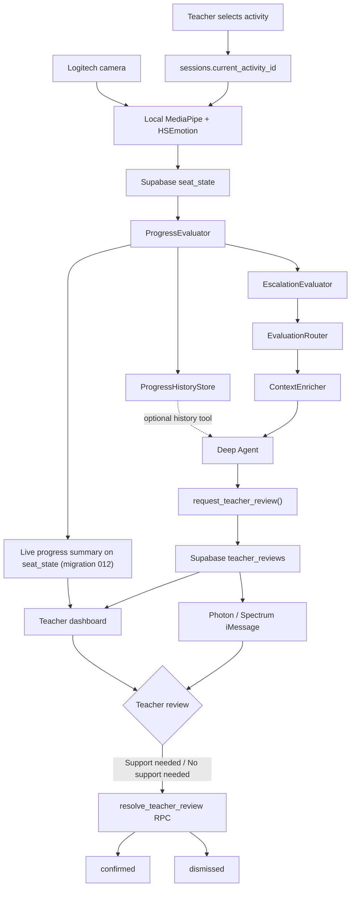

# Cues

Cues uses local vision and structured task progress to help teachers notice when
a student may need attention. Built by Keith, Michelle, and Evan for HackPrinceton 2026.

The continuous agent worker polls structured state and selects information/action
tools adaptively. Groq `openai/gpt-oss-20b` is the current demo model; the core
agent remains provider-independent through model injection. FastAPI serves local
vision/video. Pending reviews persist in Supabase; teacher resolution records a
human decision without automatically changing instruction.

Video stays local. Raw frames/images never go to the LLM. Expression context is
supporting-only, never a diagnosis or a claim about internal emotional state.
Tracking loss is not student failure. The teacher remains the final decision-maker.
Use simulated data during the hackathon.

| Component | Stack |
|---|---|
| Dashboard | Next.js / Tailwind |
| Perception | MediaPipe / HSEmotion ONNX / Logitech camera |
| Local video service | FastAPI |
| State and reviews | Supabase Postgres + Realtime |
| Agent | LangChain Deep Agents; Groq demo model |
| Notifications | Photon 2.0 through Spectrum iMessage |

| Path | Ownership / contents |
|---|---|
| `vision/` | Keith: local perception, camera, structured publication |
| `agent/` | Michelle: progress/routing, agent, reviews, notifications |
| `web/` | Evan: dashboard/app integration |
| `shared/` | Authoritative Pydantic contracts and fixtures |
| `supabase/` | Ordered migrations and SQL checks |
| `cues/` | Nested Spectrum SDK project, on-demand notification sender |
| `notes/` | Implementation details and verification |
| `STARTUP.md` | Setup, env requirements, operational troubleshooting |

See [STARTUP.md](STARTUP.md), then run `./scripts/dev.sh` to start vision, the
agent worker, and dashboard together. Photon runs on demand. Voice is not required
by this startup flow. Current person-ID dashboard/read-policy and activity catalog
alignment gaps are documented in [vision handoff](notes/vision-data.md).

Dashboard activity writes and persistent teacher review controls are connected.
Live progress requires migration 012 and explicit `agent.live_progress` /
`web.live_progress` activation. Migration 012 is deployed and both flags are enabled locally.
See [pipeline audit](notes/pipeline-audit.md) for every connection and remaining limits.
MJPEG `/stream` is the intentional local demo transport; WebRTC is not required.

Python dependencies use root uv; Node packages use their npm lockfiles. Follow
[notes/archive/TEAM_WORKFLOW.md](notes/archive/TEAM_WORKFLOW.md) for branches and ownership, and
[PRD-cues.md](PRD-cues.md) for product requirements. Shared Python contracts in
`shared/contracts.py` are authoritative.
