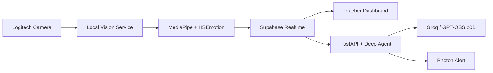

# Cues

Cues is an AI classroom support system that uses local computer vision and an agentic workflow to surface when a student may need teacher assistance.

Built by a three-person team for HackPrinceton Fall 2026. [PRD-cues.md](PRD-cues.md) defines the MVP; this checkout contains the vision service foundation, model benchmark, event emitter, and Next.js scaffold. The complete support workflow below is the MVP target, not yet an end-to-end implementation.

## What Cues does

- The teacher selects a task or speaks a push-to-talk command mapped to a known task.
- A Logitech camera observes the student locally; MediaPipe checks hand/gesture activity and HSEmotion adds optional facial-expression context.
- Structured task-progress events sync through Supabase to the teacher dashboard.
- Rules invoke the Deep Agent only for meaningful events; it uses Groq to reason over structured context and choose support tools.
- The teacher receives dashboard alerts and optional Photon notifications, then approves any meaningful instructional change.

Facial-expression output is supporting evidence only. It never independently determines that a student is struggling.

**The LLM does not receive video frames or images.**

## Current MVP stack

| Component | Technology |
|---|---|
| Frontend | Next.js + Tailwind |
| Hand tracking | MediaPipe Hand Landmarker |
| Gesture matching | Normalized landmark nearest neighbor |
| Facial-expression context | `hsemotion-onnx` + `enet_b0_8_best_vgaf` |
| Realtime state | Supabase Postgres + Realtime |
| Agent orchestration | LangChain Deep Agents |
| LLM inference | Groq + `openai/gpt-oss-20b` |
| Backend | FastAPI |
| Teacher messaging | Photon |
| Physical hardware | Logitech camera |

## High-level architecture



Perception runs on the station laptop. Only structured events are synced; rules invoke the agent for meaningful situations rather than every frame. The LLM never processes the video feed.

## Repository structure

| Path | Contents / ownership |
|---|---|
| `vision/` | Local FastAPI camera/pipeline foundation, model loaders, benchmark, event emitter, and tests — Keith |
| `web/` | Next.js App Router scaffold for the dashboard/station UI; Supabase product integration — Evan |
| `PRD-cues.md` | Product requirements, architecture, shared event schema, and team responsibilities |
| `pyproject.toml`, `uv.lock`, `.python-version` | Shared Python environment |
| `.env.example`, `vision/.env.example` | Root credentials template and current vision configuration |
| `flags.json` | Feature-flag registry |
| `.github/`, `.claude/agents/`, `CLAUDE.md`, `AGENTS.md` | CI, PR template, review guidance, and contributor/agent instructions |

Michelle owns the planned rules/agent backend. This checkout has no `agent/` or `backend/` directory yet; its existing FastAPI entry point is `vision.app:app`.

## Development setup

Install `uv`, plus Node.js/npm for the frontend. Python is pinned to **3.11** in `.python-version`; all Python components share the root environment.

```bash
git clone https://github.com/michelliez/cues.git
cd cues
uv sync
cp .env.example .env
```

Run the local vision service from the repository root:

```bash
uv run uvicorn vision.app:app --host 127.0.0.1 --port 8000
```

Open `http://127.0.0.1:8000/health` for status or `/stream` for the local camera stream. For a camera-free startup, prefix the command with `CUES_CAMERA=fake`. Keep the stream on the station laptop.

Existing checks (hardware tests skipped by default):

```bash
uv run pytest vision
uv run ruff check vision
uv run ruff format --check vision
```

The model benchmark is `uv run python -m vision.bench`; its first run downloads model weights and it uses the webcam by default.

## Frontend setup

From the repository root:

```bash
cd web
npm ci
npm run dev
```

Open `http://localhost:3000` (currently the starter page). `npm run lint` and `npm run build` are also available in `web/`. Follow [web/AGENTS.md](web/AGENTS.md) before editing frontend code.

## Environment variables

The root `.env.example` contains:

| Variable | Intended use |
|---|---|
| `SUPABASE_URL` | Supabase project URL |
| `SUPABASE_ANON_KEY` | Supabase anonymous client key |
| `SUPABASE_SERVICE_ROLE_KEY` | Privileged server-side Supabase key |
| `GROQ_API_KEY` | Agent inference credentials |
| `PHOTON_API_KEY` | Teacher notification credentials |

The current vision client separately loads `vision/.env` and expects `SUPABASE_URL` + `SUPABASE_KEY` (the station service-role key), not `SUPABASE_SERVICE_ROLE_KEY`. If configuring that client, run `cp vision/.env.example vision/.env` and fill in those values. That template also documents `CUES_STATION_ID`, optional `CUES_SESSION_ID`, and `CUES_CAMERA_INDEX`. Without Supabase credentials, the event emitter writes local JSONL files under `vision/logs/`; failed Supabase writes also fall back there.

Never commit `.env` files or secrets, and never expose service-role, Groq, or Photon keys through browser-visible `NEXT_PUBLIC_*` variables. The root template does not yet wire up the planned agent integrations.

## Contributor dependency rules

Add Python dependencies at the root with `uv add <package>` and commit **both `pyproject.toml` and `uv.lock`**. Use `uv run ...` for Python commands; do not use `pip install` as the permanent project workflow.

For frontend dependencies, run `npm install <package>` inside `web/` and commit **both `web/package.json` and `web/package-lock.json`**. Teammates install with `npm ci`. Add only dependencies needed for the task.

## Branches

These branches currently exist locally and on `origin`:

| Branch | Work area |
|---|---|
| `main` | Integration / stable shared branch |
| `frontend` | UI |
| `agent` | Deep Agents + Groq + Photon |
| `backend` | FastAPI / Supabase / rules / shared backend |
| `vision` | MediaPipe + HSEmotion + gesture matching |
| `benchmark` | CV/runtime performance testing |
| `events` | Event schema/emission |
| `setup` | Environment/tooling |

For new work, the team workflow in `CLAUDE.md` uses one ticket per `feat/<ticket>-<short-name>` branch and PR, normally based on `main`. Use the PR template and keep changes scoped.

## Product principles

- Assist teachers and keep their approval required before task, instruction, or support changes.
- No face recognition; no student video or images sent to cloud services.
- The LLM receives structured state only.
- Facial-expression context is supporting evidence only, never a diagnosis or a claim about how a student feels.
- Use simulated student data during the hackathon.
