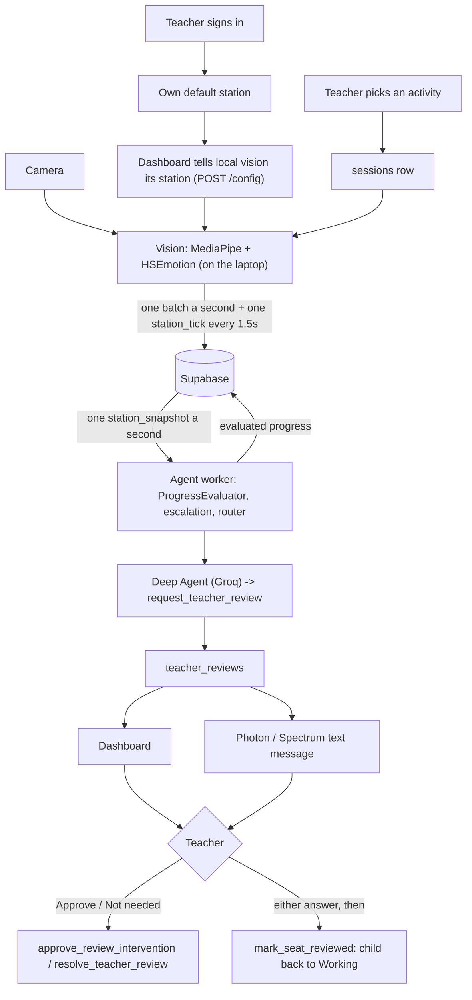

# Cues

Cues helps a special-education teacher see which students may need attention. A camera on the
teacher's laptop watches simple tasks (raise a hand, thumbs up, a gesture the teacher recorded).
A rules engine decides when a stall matters, an AI agent writes a short review request, and the
teacher decides every outcome. Student video never leaves the laptop.

Rules for working in the repo are in [CLAUDE.md](CLAUDE.md). Everything else is below.

## How it works



- **Vision** (`vision/`, FastAPI on :8000) reads the camera, tracks people by position only, scores
  the current task and publishes structured status. Each person's face crop for the expression
  model is built from their own tracked pose head points (nose, eyes, ears, mouth), filtered and
  turned upright, so there is no separate face detector and no face-to-person matching. `/stream` (MJPEG) is the local video, read
  directly by the browser.
- **Agent worker** (`agent/`) polls `seat_state` for the station's active session, tracks progress,
  and asks the LLM only when a stall is long enough. Groq `openai/gpt-oss-20b` is the demo model;
  the core is provider-independent. It never sees frames and only creates review requests.
- **Dashboard** (`web/`, Next.js on :3000) is where a teacher signs in, starts a session, sees who
  is in view, and answers review requests.
- **Database** (`supabase/`) holds ordered migrations. Run it locally with Docker.
- **Notifications** (`cues/`) is a nested Photon/Spectrum SDK project, run on demand to send the
  teacher an iMessage.
- **Contracts** (`shared/contracts.py`) are the authoritative data shapes for events, seat state,
  sessions and reviews.

## Run it

You need Python 3.11 with [uv](https://docs.astral.sh/uv/), Node 22, Docker and the
[Supabase CLI](https://supabase.com/docs/guides/local-development/cli/getting-started).

```bash
uv sync
npm --prefix web ci          # also installs cues/
supabase start               # local Postgres + Auth + Realtime; applies every migration
supabase status              # prints the URL and keys for the next step
```

Copy `.env.example` to `.env` at the repo root. It is the one env file: vision, the agent, the
dashboard, the text-message sender and the scripts all read it (never commit it). Fill in the
Supabase values from `supabase status` and your `GROQ_API_KEY`:

```
SUPABASE_URL=http://127.0.0.1:54321
SUPABASE_SERVICE_ROLE_KEY=<secret key from supabase status>
NEXT_PUBLIC_SUPABASE_URL=http://127.0.0.1:54321
NEXT_PUBLIC_SUPABASE_PUBLISHABLE_KEY=<publishable key from supabase status>
GROQ_API_KEY=<your key>
```

The `NEXT_PUBLIC_` pair is sent to the browser; the service-role key never is. Restart the
dashboard after editing `.env`; values already set in your shell win over the file.

Then:

```bash
./scripts/dev.sh             # vision + agent worker + dashboard, normal timings
./scripts/demo.sh            # same, with short timings for presenting
CUES_CAMERA=fake ./scripts/dev.sh   # no webcam
```

Open http://localhost:3000, sign up (confirmation mail appears at http://127.0.0.1:54324),
start a session, and allow camera access for your terminal in System Settings. The launcher
stops its own leftovers on start and shuts everything down on Ctrl-C. `supabase db reset` wipes
the local database; `supabase stop` shuts it down.

**Useful settings** (root `.env` or the shell):

| Variable | Use |
|---|---|
| `CUES_CAMERA_INDEX` | Webcam number (default 0; a USB camera is often 1) |
| `CUES_CAMERA` | `fake` for camera-free startup |
| `CUES_USE_STATIC_TEACHER_PHONE` | `1` sends alerts to `SPECTRUM_TEACHER_PHONE` (testing); `0` looks up the session owner's saved phone (`demo.sh` forces 0) |
| `CUES_OVERLAY` | `debug` draws every stage's detail on the video |
| `CUES_PALM_FLIP` | `1` if a camera mirrors its output |
| `CUES_STATION_ID` / `CUES_SESSION_ID` | Dev/test overrides only; normally the dashboard sends the station |

Text messages need `SPECTRUM_PROJECT_ID` and `SPECTRUM_PROJECT_SECRET` in `.env`, the
teacher to opt in under Settings > Profile, and the number added to Users on the Spectrum
website.

## Tests

There are no unit tests. Two suites check that the parts work together; both need `supabase start`:

```bash
uv run pytest tests/contract   # code, Python contracts, TypeScript parsers and the schema agree
uv run pytest tests/smoke -s   # vision follows a session, a stalled child becomes a review,
                               # the dashboard reads it, the mark after Approve resets the child
```

CI (`.github/workflows/ci.yml`) starts a local Supabase and runs both; a skipped test fails it.
Web checks: `cd web && npx tsc --noEmit && npm run lint && npm run build`.

## Online and offline

There are no feature flags. Vision is online when the root `.env` has `SUPABASE_URL` and
`SUPABASE_SERVICE_ROLE_KEY`: it follows the teacher's station and session and writes to Supabase.
Without them it runs offline on station `S1`, takes the task from `CUES_TASK`, and writes only to
`vision/logs/`. `python -m vision.watch --all-scores` prints every task's score while debugging.

## Troubleshooting

- **Camera unavailable:** allow camera access for the terminal app, check `CUES_CAMERA_INDEX`, or use fake mode.
- **"Station is in use by another camera":** a second camera or laptop holds the station; close it or sign in with its own account.
- **Port in use:** the launcher frees 3000 and 8000 when it can verify they are this repo's.
- **Supabase ports taken:** another local Supabase project is running; `supabase stop --project-id <name>`.
- **Dashboard still shows "Needs Review" after Mark as reviewed:** vision must be running; it reads the mark through its station tick.
- **Missing Supabase configuration:** the backend needs the secret key in the root `.env`; public keys are not enough.

## Status

**Working** (checked by the contract and smoke tests): teacher sign-in and default station; session
start/end and activity picker; one camera per station; person tracking by position; built-in gestures
and teacher-recorded gestures on the laptop; raise-hand; stall detection and agent review requests;
persistent reviews with Approve / Not needed (each also marks the child reviewed; people flagged before Cues asks keep a single Mark as reviewed); live evaluated
progress; Photon text on a new review; local Docker Supabase; the data behind long-term insights
(see Insights data below) and the Insights page.

**Open work**

| Item | Notes |
|---|---|
| Real-camera pass | Pointing, peace, fist; Mark as reviewed (timer restarts, new review only after a fresh stall); id stability; two laptops on two stations; the camera health strip and "waiting for review" list. Only the automated suites have run them. |
| Hosted Supabase | Measured locally for 10 people (vision + agent, demo timings, 20 s): 32.9 requests a second on `main`, 4.7 on this branch. Progress is written only when a trend changes, so that share falls toward zero once a class settles. The dashboard no longer re-reads on live updates. Not yet run against a hosted project: apply the migrations, run `tests/smoke` against it and watch its request graph. |
| Rotate exposed keys | A Groq key and a Cursor key were shown in logs earlier in the build. |
| "Add a gesture" screen | The vision API (`/gestures`, `/templates/record`) exists; there is no dashboard screen, and a recorded gesture is not registered in `activities`. |
| Interventions | The agent suggests one support from the approved menu and the teacher approves it (covered by `tests/smoke`). Applying an approved support to a task is not built. |
| Database one-writer rule | The one-camera guard is enforced in vision only; add a `writer_id` check to `seat_state` writes. |
| Review evidence | While a review is open, later evaluations are dropped, so the teacher never sees newer evidence. |
| Insights page | Built at `/insights` (sidebar link): glance cards, weekly bars, why Cues asked, how check-ins ended, supports and whether progress resumed, activities, weekday-by-hour. Not built: the written "patterns worth a look" notes. A session shows only once it has ended. |
| History | Progress and prompt history are in memory and lost on restart. |
| Person ids | By position only, so a person who leaves for 10+ seconds or two who swap seats can change ids. |
| Refactor leftovers | The dashboard header and hero controls are still inline in `web/components/dashboard.tsx`. |

**Insights data.** When a session ends, a database trigger writes one `session_summaries` row per
activity (how long it ran, check-ins asked, how each ended, supports approved and whether a success
followed within 5 minutes, which evidence was used, decision times). It holds class-level counts
only: no seat, no child, no expression data. `teacher_insights(p_from, p_to, p_activity, p_tz)`
returns one teacher's page in one request. Ending a session also deletes raw `events` older than 90
days (never those of a running session), so the summaries are the long-term record. After pulling,
apply the migration with `supabase migration up` (it also summarizes existing ended sessions).

**Ideas:** end-of-session summary; gesture tuning screen; per-session reports; moving gestures,
object-state tasks, voice (all optional); more than one camera per classroom (decided not now).

**Known limits:** one agent worker per station; Photon acceptance is not proof of handset delivery;
the model call can delay polling and cause a conservative gap reset; `/stream` MJPEG is the
intentional local transport.

## Layout

| Path | Contents |
|---|---|
| `vision/` | Camera, perception stages, task status, local API and video |
| `agent/` | Progress evaluation, routing, Deep Agent, review store, notifications, launcher |
| `web/` | Dashboard, sign-in, settings, landing page |
| `shared/` | Python contracts and fixtures |
| `supabase/` | Migrations and seed |
| `cues/` | Spectrum SDK sender (nested project) |
| `tests/` | Contract and smoke tests |
| `scripts/` | `dev.sh`, `demo.sh`, cleanup tools |
