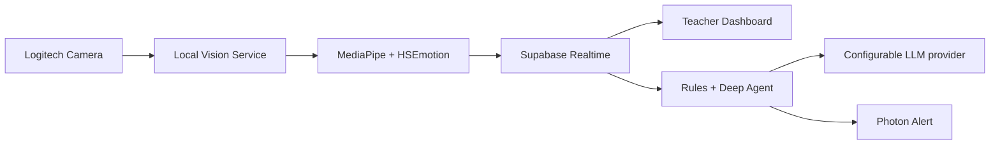

# Cues — Team Workflow

This file defines how the 3-person Cues team builds independently and integrates safely.

## Team branches

| Person | Branch | Owns |
|---|---|---|
| Keith | `keith` | Computer vision / local perception |
| Evan | `evan` | Frontend + app backend / Supabase UI |
| Michelle | `michelle` | Rules engine + Deep Agent + LLM integration + Photon |

`main` is the shared integration branch.

Each person should primarily edit their own area and avoid changing another person's files unless necessary for integration.

---

## 1. System split

### Keith — CV / local perception

Primary responsibility:

```text
Camera
  ↓
MediaPipe
  ↓
Gesture matching
  ↓
HSEmotion
  ↓
Structured events
  ↓
Supabase
```

Owns:

- webcam capture
- MediaPipe Hand Landmarker
- normalized hand landmarks
- teacher-recorded gesture templates
- nearest-neighbor gesture matching
- match-score calibration
- raise-hand rule
- HSEmotion
- expression-context signal
- tracking-loss handling
- structured perception events

Keith does **not** decide when the teacher should be alerted.

Keith's output is structured state/events.

---

### Evan — frontend / app backend / Supabase-facing product

Primary responsibility:

```text
Supabase
  ↕
Next.js
  ↓
Teacher dashboard + station UI
```

Owns:

- Next.js
- Tailwind
- teacher dashboard
- student/station page
- app backend and app-facing APIs
- Supabase schema and realtime subscriptions
- seat cards
- task controls
- push-to-talk voice commands
- gesture-recording UI
- alert UI
- approve / dismiss controls
- review queue
- simulated students

Evan should be able to build the UI using fake/sample data before CV or the agent is connected.

---

### Michelle — routing / rules / agent

Primary responsibility:

```text
Supabase events
  ↓
Rules engine
  ↓
Deep Agent
  ↓
Configurable LLM provider
  ↓
Tool actions
  ├── Supabase alert
  └── Photon notification
```

Owns:

- rules engine
- event routing
- alert cooldowns
- Deep Agents
- provider-neutral LLM integration
- agent tools
- support-preference retrieval
- intervention selection
- teacher-alert creation
- Photon
- approval workflow
- deterministic fallback when the LLM is unavailable

LLM provider and model selection is undecided; Groq and SpaceXSI are under consideration. Keep provider integration configurable and separate from routing and tool logic.

Michelle's code receives **structured state only**.

The LLM must never receive camera frames.

---

## 2. Shared architecture



---

## 3. Shared contracts

These interfaces are shared by all three components and must be changed carefully.

Agreed contract decisions:

- Session IDs and alert IDs are UUIDs; station, seat, and activity IDs remain strings.
- Preserve all 12 event types listed below.
- Retain `SeatState.session_id` and `SeatState.updated_at`, plus `Alert.created_at` and nullable `Alert.resolved_at`, from PRD §17.
- Expression context uses `label` and `probability`; sustained events also carry `duration_seconds` and `supporting_only: true`.
- An activity uses `id`; other objects reference it with `activity_id`.
- The Pydantic models in `shared/contracts.py` are authoritative for exchanged data; these JSON examples are illustrative. Synthetic examples live in `shared/fixtures/`. The vision emitter validates and serializes these shared models.

All three parts should be able to develop against fake versions of these objects.

### 3.1 `events`

Written by CV / backend.

Read by rules + agent.

Example:

```json
{
  "session_id": "550e8400-e29b-41d4-a716-446655440000",
  "station_id": "S1",
  "seat_id": "S1-L",
  "type": "attempt_miss",
  "activity_id": "custom_gesture_01",
  "score": 0.31,
  "payload": {},
  "created_at": "2026-11-14T02:00:00Z"
}
```

Event types:

```text
attempt_success
attempt_miss
review_needed
no_progress
tracking_lost
expression_context
teacher_verified
agent_invoked
alert_created
teacher_approved
teacher_dismissed
intervention_applied
```

---

### 3.2 `seat_state`

Written/updated from perception + backend state.

Read by the frontend.

Example:

```json
{
  "seat_id": "S1-L",
  "session_id": "550e8400-e29b-41d4-a716-446655440000",
  "activity_id": "custom_gesture_01",
  "status": "in_progress",
  "task_score": 0.31,
  "expression_context": {
    "label": "neutral",
    "probability": 0.74,
    "supporting_only": true
  },
  "updated_at": "2026-11-14T02:00:00Z"
}
```

Status values:

```text
idle
in_progress
review
done
needs_help
tracking_lost
```

---

### 3.3 `alerts`

Written by Michelle's rules/agent system.

Read and updated by Evan's frontend.

Example:

```json
{
  "id": "550e8400-e29b-41d4-a716-446655440001",
  "seat_id": "S1-L",
  "reason": "stalled_progress",
  "priority": "high",
  "suggestion": "Demonstrate the gesture again",
  "evidence": {
    "stalled_seconds": 30,
    "expression_signal": true
  },
  "status": "pending",
  "created_at": "2026-11-14T02:00:10Z",
  "resolved_at": null
}
```

Alert status:

```text
pending
approved
dismissed
```

---

### 3.4 `activities`

Created/selected by the app.

Read by the perception pipeline.

Example:

```json
{
  "id": "custom_gesture_01",
  "name": "Custom Gesture 1",
  "check_type": "gesture",
  "success_threshold": 0.78,
  "review_threshold": 0.58,
  "no_progress_seconds": 30
}
```

Task thresholds are activity-specific.

Do not introduce one universal confidence threshold for every type of task.

---

## 4. Development rule: nobody waits for anyone

### Keith

Develop against local/fake task configuration.

Initially print events:

```text
EVENT attempt_miss
EVENT attempt_success
EVENT expression_context
```

Then replace the local emitter with Supabase writes.

### Evan

Develop with sample JSON for:

```text
seat_state
alerts
activities
```

The dashboard should work before real CV or the real agent exists.

### Michelle

Develop with fake events.

Example:

```text
timestamped task observations
→ rolling progress window
→ sustained stall
```

should be enough to test:

```text
rules trigger
→ agent invoked
→ tools selected
→ alert created
```

No camera or frontend should be required to test the agent system.

---

## 5. Facial-expression rule

HSEmotion is supporting context only.

Correct:

```text
repeated task difficulty
+
sustained expression signal
→ higher-priority context
```

Incorrect:

```text
sad face
→ student is struggling
```

Facial expression alone must never determine task failure or trigger a diagnosis.

---

## 6. Integration order

Integrate in this order:

```text
1. CV → Supabase
2. Supabase → Dashboard
3. Supabase → Rules
4. Rules → Agent
5. Agent → Alerts
6. Alerts → Dashboard
7. Agent → Photon
8. Teacher approval → approved action
```

Do not attempt full-system integration before the earlier connections work.

---

## 7. Git workflow

Branches:

```text
main
keith
evan
michelle
```

`main` is integration only.

Before starting work:

```bash
git switch <your-name>
git pull
git merge main
```

Commit small, scoped changes.

Push regularly:

```bash
git add .
git commit -m "<short description>"
git push
```

Before merging into `main`, pull the latest `main` into your branch and resolve conflicts there.

Do not force-push during the hackathon unless the whole team explicitly agrees.

---

## 8. Shared dependency rules

Python uses:

```text
uv
pyproject.toml
uv.lock
```

Add Python packages only with:

```bash
uv add <package>
```

Do not use `pip install` as the permanent project workflow.

Frontend dependencies use npm:

```bash
cd web
npm install <package>
```

Commit both lockfiles when dependencies change.

---

## 9. Product constraints shared by everyone

- Product name is **Cues**.
- Teacher assistance, not teacher replacement.
- No face recognition.
- No ESP32 / Arduino / LEDs / physical buttons.
- No YOLO / MobileNet object-state pipeline in the MVP.
- No Amazon Bedrock dependency.
- Student camera frames stay local.
- The LLM receives structured state only.
- Expression is supporting evidence only.
- Teacher approval is required before instructional changes.
- Voice task commands remain part of the MVP.

---

## 10. Definition of successful independent work

Before shared integration:

### Keith can demonstrate

```text
camera → gesture/expression → structured event
```

### Evan can demonstrate

```text
fake Supabase/sample state → responsive dashboard + alerts UI
```

### Michelle can demonstrate

```text
fake events → rules → Deep Agent → structured alert
```

Once all three work independently, begin shared integration using the order in Section 6.

## Rolling progress evaluation

The primary automatic routing trigger is sustained lack of progress, not a miss count. Keith supplies fresh task observations; Evan owns app state; Michelle evaluates the rolling window. `SeatState.tracking_valid` explicitly reports task tracking usability; unknown is not valid. For evaluator input, `updated_at` is the task observation time; expression-only/app updates must not masquerade as fresh task samples.

The in-memory evaluator compares earlier/later half-window means (initial window 6 seconds, minimum increase 0.10), sampling at most once per second. These are tunable demo settings, not validated cutoffs. Improving progress resets the stall timer. Incomplete valid history yields unknown. Boolean rule tasks use valid observed time without completion rather than an invented score. Activity.no_progress_seconds determines the stall timeout.

Expression only modifies urgency after task progress qualifies; it never triggers evaluation alone or shortens the timeout in this version. Tracking loss, unknown validity, or gaps over two seconds clear history and reset timing. Completion stops evaluation immediately; discard late agent results for completed tasks. Restarting the same activity requires explicit reset. Evaluate once per stall episode, re-arming after improvement/reset; later routing also enforces seat/reason cooldowns. Evaluation does not itself create an alert.

Verify with timestamped improving, stalled, expression-only, tracking-loss/recovery, and completion sequences before agent integration. Keep all 12 event types as log vocabulary. Calibrate window, minimum increase, observation cadence, and activity timeouts with actual CV outputs.
