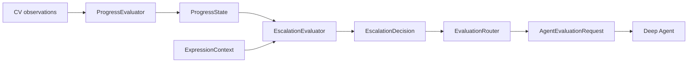

# Michelle — routing / agent engineering log

# Architecture


- **ProgressEvaluator:** Is the student making progress?
- **EscalationEvaluator:** Is this situation worth asking the agent about?
- **Evaluation Router:** Should we invoke the agent now, or have we already evaluated this situation?
- **Deep Agent:** What, if anything, should Cues do?

Add a concise entry here whenever a meaningful routing/agent step is completed.

## Previous work — rolling progress window

We rejected “3 failed attempts” as the primary routing model because a physical
response may be partial, held, hesitant, or gradually improving rather than three
separate attempts. Continuous timestamped observations better represent this.

`agent/progress.py` consumes shared `SeatState` snapshots and returns internal
`ProgressState(trend, stalled_seconds)`. Trends are `improving`, `stalled`,
`completed`, and `unknown`. No shared progress-result contract was added.

Actual implementation: a configurable four-second window compares early/later
half-window score means. Improvement enters at an increase of 0.10 and remains
improving until the increase drops below 0.05. One observation per half-second
bucket bounds memory and limits burst weighting. A boundary observation permits
irregular sampling; only in-window scores enter the comparison. These tunable
score changes are not probabilities or validated learner thresholds.

Stall duration uses observation timestamps from the first valid observation or
last improving evaluation. Incomplete window coverage is unknown. Gesture tasks
require a score; rule tasks use valid observation time without completion, without
inventing a score. Gesture completion uses the supplied activity success threshold;
explicit `done` also completes. Completion is normally latched until reset or a
session/seat/activity change. Duplicate/out-of-order observations do not advance
time; stale input can invalidate state. Future observations are ignored. Invalid
or unknown tracking, missing gesture scores, idle/tracking-lost status, and gaps
over two seconds clear history and reset stall timing. Same-task restarts require
`reset()`. No missing interval counts as student failure. Fresh task timestamps
must not be replaced by unrelated app/expression update timestamps.

The earlier prototype's expression and agent-action fields were removed. The
current progress evaluator neither reads expressions nor requests agent calls.
It does not use `Activity.no_progress_seconds` to decide escalation.

## Current work — deterministic escalation evaluator

`agent/escalation.py` adds a pure function:

```python
evaluate_escalation(progress_state, expression_context=None,
                    *, config=DEFAULT_ESCALATION_CONFIG)
```

It returns a frozen internal dataclass `EscalationDecision` with
`should_evaluate`, `priority` (`normal`, `elevated`, or None), and `reason`
(`stalled_progress`, `stalled_progress_with_expression_context`,
`prolonged_stalled_progress`, or None). False decisions have no priority/reason.
Shared Pydantic contracts are unchanged. Configuration is a frozen validated
`EscalationConfig`; pass the selected object explicitly. There are no demo-mode
branches, external calls, alerts, instructional changes, or cooldown logic.

| Setting | Classroom/default | Accelerated demo |
|---|---:|---:|
| min_observation_seconds | 5 | 2 |
| expression_assisted_seconds | 6 | 5 |
| normal_stall_seconds | 10 | 4 |
| prolonged_stall_seconds | 15 | 6 |

All durations are seconds. No escalation before the minimum. Only `stalled` can
qualify; improving, completed, and unknown cannot, regardless of expression.
Stalled duration is used conservatively as a lower bound on valid observation
time, so no extra observed-duration field is necessary. The prolonged threshold
wins first and yields elevated priority. Otherwise qualifying expression permits
an earlier/elevated evaluation; otherwise the normal threshold yields normal
priority. Threshold comparisons are inclusive. Each call describes eligibility;
repeated calls may return true. Deduplication/cooldowns are future work.

Supporting expression context requires a native anger/fear/sadness model label,
probability at least 0.50, and sustained duration at least five seconds. These
configurable qualification values are unchanged between timing presets. Missing
duration, neutral output, or weak/brief output cannot accelerate evaluation.
This is model context, not a verified internal state or diagnosis. The caller
must supply fresh context for the same task; ExpressionContext has no timestamp,
so this pure layer cannot independently establish freshness. Never reuse stale
context across tasks. Expression cannot bypass the stalled-progress gate.

Demo timings compress live judging delays; they are not classroom recommendations.
The classroom/default progress window remains four seconds. Demo callers explicitly
use `ProgressEvaluator(activity, window_seconds=DEMO_PROGRESS_WINDOW_SECONDS)`;
the named demo constant is two seconds. Expression persistence remains five seconds.
With a continuous valid stalled sequence, normal eligibility at four seconds,
expression elevation at five, and prolonged elevation at six are all reachable.
The demo expression branch elevates priority after normal eligibility; it does not
accelerate eligibility. These timings are for presentation speed only, not classroom
recommendations. Configuration permits either expression/normal ordering while
requiring both thresholds to fall within minimum/prolonged bounds.

Tracking behavior is preserved: the progress evaluator clears invalid history
and returns unknown; escalation cannot advance its own clock or count missing
observations. Consume only freshly updated ProgressState results.

ProgressEvaluator asks: “Is the student making progress?”

EscalationEvaluator asks: “Is this situation worth asking the agent about?”

Future Deep Agent asks: “What, if anything, should Cues do?”

An escalation decision does **not** automatically imply a teacher notification,
that a student needs help, or permission to change instructions.

Verification: 33 new escalation tests cover both presets, non-stalled gates with
and without expression, requested classroom/demo examples, exact boundaries,
weak/brief/missing expression persistence, and invalid configuration/durations.
`uv run --no-sync pytest agent/tests shared/tests vision`: 137 passed, 3 skipped
(camera/model and credential-dependent integration checks). Ruff check passed.
No LLM, Deep Agents, provider integration, Photon, Supabase, endpoint, or alert
cooldown implementation was added. Existing progress changes were preserved.

## Demo timing consistency fix

Kept classroom escalation at 5/6/10/15 and default progress at four seconds.
Changed demo escalation to 2/5/4/6 and added an explicit two-second demo progress
window constant. Kept expression persistence at five seconds. Updated boundary
checks and added a timestamped end-to-end progress/escalation test proving each
demo branch is reachable, plus a short-expression regression test. Verification:
139 tests passed, 3 skipped; lint and formatting passed. No architecture,
shared contract, routing side effect, deduplication, or cooldown was added.

## Citations

These sources support allowing processing time, not treating a few seconds as
failure. They do **not** establish universal Cues timeouts or validate facial
expression routing. Our 5/6/10/15 defaults are conservative engineering choices
informed by these ranges; activity/learner calibration remains future work.
The 2/5/4/6 preset is demonstration-only.

- [IRIS Center, Vanderbilt — Wait-Time](https://iris.peabody.vanderbilt.edu/et/wp-content/uploads/misc_media/fss/pdfs/2018/IRIS_fundamental_skill_sheet_wait-time.pdf).
  The supplied PDF redirects to the current skill sheet. It describes benefits
  of 3–5 seconds across groups including students with disabilities, supporting
  an opportunity to process and begin responding before intervention.
- [NPDC — Prompting: Least-to-Most, Steps for Implementation](https://autisminternetmodules.org/storage/ocali-ims-sites/ocali-ims-aim/documents/PromptsLeasttoMostSteps.pdf).
  Response intervals are initially around 3–5 seconds and should reflect learner
  and task characteristics; initiation and completion intervals can differ.
- [STAR Autism Support — Routine Essentials: Prompting Strategies](https://starautismsupport.com/sites/default/files/CEC_STAR_Inclusion_2025.pdf), page 12 of the booklet.
  Gives 5–10 seconds as an example opportunity to respond before prompting.
- [Johnson & Parker — Effects of Wait Time when Communicating with Children who have Sensory and Additional Disabilities](https://journals.sagepub.com/doi/10.1177/0145482X1310700505), Journal of Visual Impairment & Blindness.
  The abstract describes three participants and 5-, 10-, and 15-second conditions
  compared with a 0–1-second baseline. Responses were more frequent during
  intervention; the implications suggest at least five seconds may help. This
  small communication study does not establish gesture-task escalation thresholds.
- [Stahl — Using Think-Time and Wait-Time Skillfully in the Classroom](https://eric.ed.gov/?id=ED370885), ERIC Digest.
  Supports uninterrupted processing intervals of several seconds rather than
  interpreting immediate nonresponse as failure. The ERIC abstract was verified through search after direct access timed out;
  it describes benefits after at least three seconds of uninterrupted silence.
- [Goodwin et al. — Effective Classroom Questioning, ERIC ED285497](https://files.eric.ed.gov/fulltext/ED285497.pdf).
  Discusses processing/formulating responses, benefits of several seconds of
  wait-time, and context-specific cautions about 20–30-second silent waits.
  This classroom question-answer guidance is not a universal maximum for physical
  tasks or learners who need longer response times.
